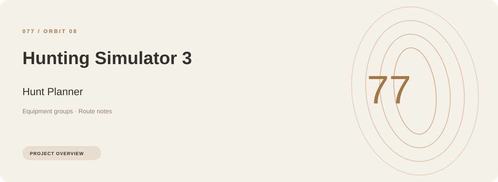
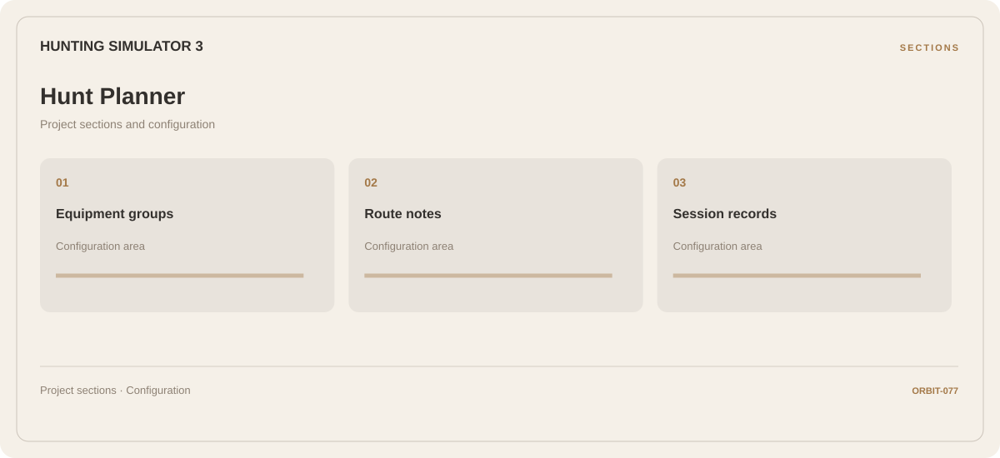

# 🎮 Hunting Simulator 3 Hunt Planner

**Equipment groups · Route notes · Session records**

## ⚡ Features

The Hunting Simulator 3 hunt planner workflow separates equipment groups from route notes and session records. Named sections make the available options easier to find.

### ⚙️ Equipment groups

Equipment categories and the associated selection or configuration options.

### 🧩 Route notes

Route stages, transport context, and the notes associated with each part of the journey.

### ⌨️ Session records

Session and activity information grouped by the task or context it belongs to.

## 🖥️ Project navigation

## 📥 Download

The button and cover open the project's download page. Use the information supplied with the downloaded package for installation and release-specific requirements.

## 📚 Project documentation

- [Feature reference](docs/FEATURES.md)
- [Download information](docs/DOWNLOAD.md)
- [Project page](index.html)

---

Hunting Simulator 3 Hunt Planner · Program documentation and download information.
